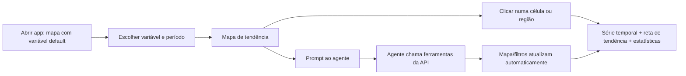
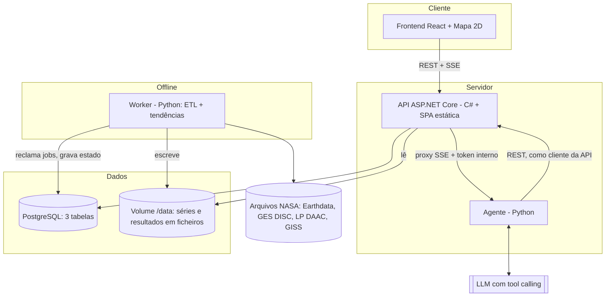
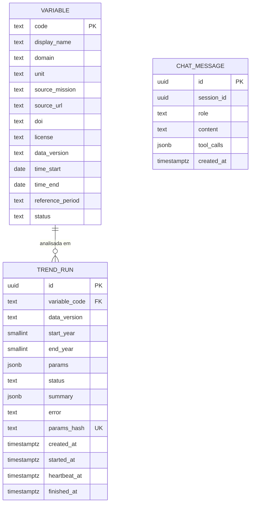
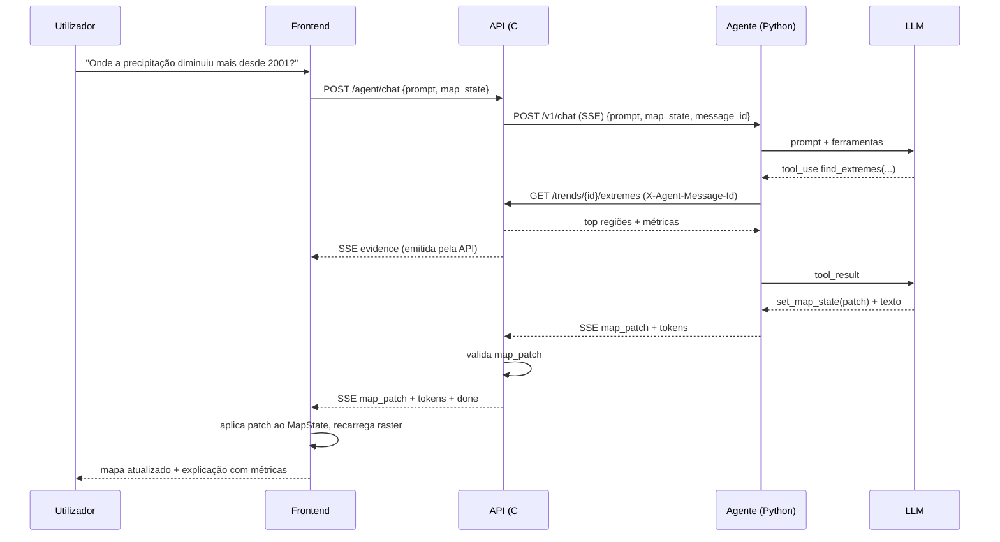

# Earth System Trend Detective — Documento de Arquitetura (v3)

> **Estado:** v0.3 (rascunho para a equipa) · **Âmbito:** MVP + caminho de evolução
> **Stack:** **C#** (API) · **Python** (agente de IA + worker científico) · **PostgreSQL** (base de dados) · **React** (frontend)

## O que mudou face à v0.2

| Tema | v0.2 | **v0.3 (este documento)** |
|---|---|---|
| Variáveis | 3–5 candidatas | **3 fixas** |
| Visualização | Globo 3D | **Mapa 2D da Terra** (projeção equirretangular) |
| Tabelas na BD | 17 (com PostGIS) | **3** (sem PostGIS) |
| Séries e resultados por célula | Linhas/arrays no PostgreSQL | **Ficheiros binários planos** num volume; a BD guarda só metadados, jobs e chat |
| Grelha | Configurável (`grid_definition`) | **Uma única grelha fixa de 2°** (constante no código) |
| Período | Mês, com sazonalidade | **Anos inteiros, sem sazonalidade** no MVP |
| Regiões | Tabelas com geometria PostGIS | **Ficheiro GeoJSON estático** (~10 regiões) |
| Partilha | Tabela + endpoints `/share` | **`MapState` no URL** |
| Contentores | web, api, agent, worker, db | **api (serve também o React), agent, worker, db** |
| Código Python | Dois projetos | **Um projeto, dois pontos de entrada** (agente e worker) |

> **Nota sobre a stack:** como o projeto ainda está em fase de ideia, a secção 3 descreve a stack **decidida para o MVP**. Se a equipa já usa algo diferente, esta é a secção a ajustar.

---

## 1. Visão de produto

### 1.1 Problema
O sistema Terra muda continuamente, mas a mesma variável pode subir numa região e descer noutra, mesmo quando o processo físico é o mesmo. Os dados da NASA existem, mas estão dispersos em formatos (NetCDF, HDF5, GeoTIFF), grelhas e resoluções diferentes. Responder a *"o que está a mudar, onde, quanto, e é significativo?"* exige conhecimento técnico que a maioria das pessoas não tem.

### 1.2 Proposta de valor
Um mapa interativo onde qualquer pessoa pode **ver, perguntar e verificar** tendências ambientais:

| Pergunta | Como o produto responde |
|---|---|
| **O quê** está a mudar? | 3 variáveis NASA de domínios diferentes |
| **Onde**? | Mapa de tendências (sinal e magnitude por célula de 2°) |
| **Quanto**? | Declive (Sen) em unidades por década + intervalo de confiança |
| **É significativo?** | Teste Mann-Kendall com correção de autocorrelação e FDR; células não significativas ficam atenuadas |

### 1.3 Princípio de design central
> **O agente de IA nunca inventa números. Ele traduz linguagem natural em ações sobre ferramentas determinísticas.**
> Todo valor mostrado ao utilizador vem de um cálculo reprodutível (`trend_run`), nunca do texto gerado pelo modelo.

Com duas linguagens no sistema, o princípio ganha uma garantia estrutural: **a evidência mostrada na UI é emitida pela API C#, a partir do que ela própria serviu ao agente**, e não pelo agente (ver 6.3).

### 1.4 Personas
- **Estudante/curioso:** quer explorar e perguntar em linguagem natural.
- **Analista/educador:** quer comparar regiões e ver a metodologia.
- **Júri/revisor do desafio:** quer ver rigor estatístico e rastreabilidade da fonte.

### 1.5 Fluxo principal do MVP



**Histórias de utilizador do MVP (ordem de prioridade):**
1. Escolho uma das 3 variáveis e um período e vejo o mapa de tendência.
2. Clico numa célula e vejo a série temporal, a reta de tendência, o declive, o intervalo de confiança e o p-value.
3. Escrevo *"onde a precipitação diminuiu mais desde 2001?"* e o mapa muda para a variável/região/período corretos, com uma explicação curta e as métricas usadas.
4. Vejo sempre a fonte (missão, produto, versão, DOI) e a metodologia da camada atual.
5. Partilho o estado do mapa por URL.

**Fora do MVP (explícito):** contas de utilizador, upload de dados, **sazonalidade**, **regiões desenhadas pelo utilizador**, **mais de 3 variáveis**, grelhas mais finas que 2°, previsão, mobile nativo.

### 1.6 As 3 variáveis do MVP

| # | Domínio | Variável | Fonte provável | Grelha nativa → 2° | Período aproximado |
|---|---|---|---|---|---|
| 1 | Atmosfera | Anomalia de temperatura da superfície | GISS **GISTEMP** (grelhado) | 2° → 2° (**sem reamostragem**) | A partir de 1980 (decisão de escopo) |
| 2 | Hidrosfera | Precipitação mensal | **GPM IMERG** (GES DISC) | 0,1° → 2° (média por blocos) | 2001 em diante |
| 3 | Biosfera | Índice de vegetação (NDVI) | **MODIS** (LP DAAC), produto mensal global | 0,05° → 2° (média por blocos) | 2001 em diante |

*(Confirmar disponibilidade, versão, período e licença nos catálogos oficiais antes de fechar; os valores acima são pontos de partida.)*

**Porquê estas três:**
- Domínios diferentes e **grelha global** (o mapa fica "completo").
- **Precipitação e NDVI costumam mostrar tendências opostas em regiões diferentes**, que é o ponto narrativo do desafio. Validar nos dados reais antes da demo; se não aparecer, trocar a variável 3 por outra candidata.
- **GISTEMP já vem em 2°**, logo é a melhor variável para o esqueleto andante da fase 0.
- **Período comum:** 2001 em diante serve as três, o que permite comparar variáveis no mesmo intervalo.

**Deixadas de fora de propósito:** gelo marinho (grelha polar estereográfica exige reprojeção e o mapa equirretangular distorce os polos) e nível do mar (só oceano e poucas regiões com sinal contrário). São boas candidatas para a fase 5.

---

## 2. Arquitetura de alto nível

Decisão: **quatro contentores** num único `docker compose`: `api` (C#, serve também o React), `agent` (Python), `worker` (Python), `db` (PostgreSQL). Sem broker, sem cache distribuída, sem armazenamento de objetos.



**Separação de responsabilidades:**

| Componente | Linguagem | Responsabilidade | O que **não** faz |
|---|---|---|---|
| **Frontend** | TypeScript/React | Mapa, filtros, gráficos, `MapState` | Não calcula estatística |
| **API** | C# | Único ponto de entrada; contratos; esquema da BD; leitura de séries e resultados; validação de `map_patch`; emissão de `evidence`; rate limit | Não calcula Mann-Kendall nem lê NetCDF |
| **Agente** | Python | Linguagem natural → ferramentas → `map_patch` + texto | Sem BD nem ficheiros; só fala com a API |
| **Worker** | Python | ETL; anomalias; tendências; FDR; agregação regional; render do PNG | Não serve utilizadores |
| **PostgreSQL** | — | Catálogo de variáveis, fila e estado de jobs, histórico do agente | Não guarda séries nem grelhas |

**Regra de ouro da propriedade:** **só a API C# altera o esquema** (migrações EF Core). O worker escreve em ficheiros e no estado dos jobs (matriz em 6.4); o agente não escreve em nada.

---

## 3. Stack técnica (decidida para o MVP)

| Camada | Escolha | Porquê |
|---|---|---|
| Frontend | **React 19 + TypeScript + Vite** | Ecossistema; tipos gerados do contrato da API |
| Mapa 2D | **Leaflet + react-leaflet** com `CRS.EPSG4326` (projeção equirretangular), `ImageOverlay` do PNG de tendência e contornos de países em **GeoJSON local** (Natural Earth) | O PNG da grelha 2° encaixa exatamente nos limites `[-90,-180]→[90,180]`, sem reprojeção, **sem tiles externos** (a demo funciona sem rede) |
| Gráficos | **Apache ECharts** | Séries temporais com bandas de confiança |
| Estado/dados no cliente | **Zustand** (`MapState`) + **TanStack Query** | Estado único serializável em URL; *polling* de runs |
| API | **C# / ASP.NET Core (.NET 10 LTS)**, Minimal APIs; serve também o *build* do React (`wwwroot`) | Tipagem forte, OpenAPI nativo, SSE nativo, sem CORS nem contentor web separado |
| Acesso a dados (C#) | **EF Core + Npgsql** (sem PostGIS) | 3 tabelas simples; migrações versionadas |
| Leitura de ficheiros (C#) | `RandomAccess` / `FileStream` + `IMemoryCache` | Ler uma série é um *seek* e um *read* |
| Resiliência e limites (C#) | `Microsoft.Extensions.Http.Resilience`, `Microsoft.AspNetCore.RateLimiting`, FluentValidation | *Timeouts* ao falar com o agente; contratos estritos |
| Observabilidade | **Serilog + OpenTelemetry** (`traceparent` propagado web → API → agente → API) | Seguir um prompt de ponta a ponta |
| Agente | **Python 3.12 + FastAPI + sse-starlette + Pydantic v2 + httpx** | Ecossistema de LLM; SSE |
| LLM | **API da Anthropic com tool use** | Saída estruturada e verificável |
| Worker científico | **Python 3.12 + xarray, NumPy, SciPy, pymannkendall (ou versão vetorizada), earthaccess, h5netcdf, shapely, Pillow, psycopg 3** | Padrão para dados gradeados e estatística |
| Base de dados | **PostgreSQL 16** | Catálogo, fila de jobs e histórico do agente |
| Fila de jobs | **Tabela `trend_run` + `FOR UPDATE SKIP LOCKED`** | Sem Redis/RabbitMQ |
| Contratos | **OpenAPI emitido pela API C#** → `openapi-typescript` (TS) e `datamodel-code-generator` (Pydantic) | Uma fonte, três linguagens |
| Infra MVP | **Docker Compose** (`api`, `agent`, `worker`, `db`) + volume `/data` | Um comando para subir tudo |
| Qualidade | **xUnit + Testcontainers** (C#), **pytest + Ruff + mypy** (Python), **Vitest + Playwright** (web), GitHub Actions | Testes de contrato e *golden files* para estatística |

**Porquê Leaflet em `EPSG4326` e não o Web Mercator habitual:** o Mercator esticaria o PNG nas latitudes altas (Gronelândia enorme, Antártida absurda) e exigiria reprojetar o raster; para um mapa científico de tendências isso é um defeito, não um detalhe. O custo é não haver mapa-base fotográfico; os contornos de países chegam.

---

## 4. Metodologia de tendências (o núcleo científico)

Esta secção é parte da arquitetura porque define **o que é "significativo"** e tem de ser idêntica em toda a app. **Existe uma única implementação: o worker Python.** A API C# nunca recalcula estatística; só lê e serve resultados.

1. **Dados de entrada:** valores mensais por célula de 2°. Reamostragem (média por blocos) feita **no ETL**, uma só vez.
2. **Anomalias:** valores face a uma climatologia mensal de um período de referência **fixo por variável**, registado em `meta.json`. Se o produto já vier em anomalia (caso do GISTEMP), usa-se tal como vem e regista-se a sua referência.
3. **Período:** **anos inteiros** (`start_year`–`end_year`); tendência calculada sobre as anomalias mensais desses anos. Sem sazonalidade no MVP.
4. **Declive:** estimador de **Theil–Sen** (robusto a outliers), expresso em *unidade por década*; guardar também `intercept` (valor ajustado no 1.º mês) para a API desenhar a reta sem recalcular.
5. **Significância:** teste de **Mann–Kendall** com correção de autocorrelação (ex.: Hamed–Rao ou pré-branqueamento). Limiar `α = 0,05`.
6. **Múltiplos testes espaciais:** com milhares de células, ~5 % serão "significativas" por acaso. Aplicar **FDR (Benjamini–Hochberg)** e guardar ambos os p-values.
7. **Agregação regional:** média ponderada por `cos(latitude)` das células cujo centro cai na região (GeoJSON), antes de calcular a tendência da região.
8. **Dados em falta:** exigir cobertura mínima (ex.: ≥ 80 % dos meses) ou a célula fica `NaN`.
9. **Reprodutibilidade:** cada resultado fica ligado a uma `trend_run` com todos os parâmetros e à `data_version` usada.
10. **Desempenho:** 16 200 células × Mann-Kendall com correção é caro em ciclo Python puro; vetorizar/paralelizar por blocos e medir na fase 0.

> **Aviso a tornar visível na UI:** "significativo" aqui é significância estatística da tendência linear monotónica no período escolhido. Não implica causa, nem que a tendência continue no futuro. Períodos curtos (< 15 anos) são sensíveis à escolha dos anos.

---

## 5. Modelo de dados

### 5.1 Princípio de separação
- **PostgreSQL guarda só o que é relacional e pequeno:** catálogo das 3 variáveis, jobs/resultados resumidos (`trend_run`) e histórico do agente.
- **Séries e resultados por célula vivem em ficheiros binários planos** num volume `/data`. A API C# lê-os sem bibliotecas especiais e o worker Python escreve-os com `numpy.tofile`. Não há PostGIS, nem arrays em SQL, nem milhões de linhas.
- **Tamanho:** BD abaixo de alguns MB. Em disco, a grelha de 2° tem 16 200 células; por variável: temperatura (1980–hoje, ~560 meses) ≈ **36 MB**, precipitação e NDVI (2001–hoje, ~300 meses) ≈ **19 MB** cada. Total de séries ≈ **75 MB**. Cada run ocupa ~0,5 MB (`cells.f32`) + PNG de poucos KB.

### 5.2 Diagrama entidade-relação



`CHAT_MESSAGE` não tem relações: `session_id` é um GUID gerado no browser; **não há tabela de sessões**. As chamadas a ferramentas e a evidência ficam em `tool_calls` (jsonb) na mensagem do assistente.

### 5.3 DDL (PostgreSQL)

> Na prática o DDL é **gerado pelas migrações EF Core**; este é o desenho-alvo de referência.

```sql
CREATE EXTENSION IF NOT EXISTS pgcrypto;

-- 1. Catálogo (as 3 variáveis; escrito pelo worker ao publicar dados) -
CREATE TABLE variable (
    code              text PRIMARY KEY,               -- 'temperature' | 'precipitation' | 'ndvi'
    display_name      text NOT NULL,
    domain            text NOT NULL CHECK (domain IN ('atmosphere','hydrosphere','biosphere')),
    unit              text NOT NULL,
    source_mission    text NOT NULL,                  -- ex.: 'NASA GISS GISTEMP'
    source_url        text,
    doi               text,
    license           text,
    data_version      text NOT NULL,                  -- versão ativa dos dados
    time_start        date NOT NULL,                  -- 1.º mês de series.f32
    time_end          date NOT NULL,
    reference_period  text NOT NULL,                  -- ex.: '1951-1980'
    status            text NOT NULL DEFAULT 'inactive'
                      CHECK (status IN ('inactive','ready'))
);

-- 2. Execuções de tendência (job + resultado resumido) ---------------
CREATE TABLE trend_run (
    id              uuid PRIMARY KEY DEFAULT gen_random_uuid(),
    variable_code   text NOT NULL REFERENCES variable(code),
    data_version    text NOT NULL,
    start_year      smallint NOT NULL,
    end_year        smallint NOT NULL,
    params          jsonb NOT NULL DEFAULT '{}',      -- alpha, cobertura mínima...
    status          text NOT NULL DEFAULT 'pending'
                    CHECK (status IN ('pending','running','ready','failed')),
    summary         jsonb,                            -- média global, % células signif., min/max
    error           text,
    params_hash     text NOT NULL UNIQUE,             -- idempotência / cache
    created_at      timestamptz NOT NULL DEFAULT now(),
    started_at      timestamptz,
    heartbeat_at    timestamptz,
    finished_at     timestamptz,
    CHECK (end_year >= start_year)
);
CREATE INDEX trend_run_queue_ix ON trend_run (created_at) WHERE status = 'pending';

-- 3. Histórico do agente (auditoria e evidência) ---------------------
CREATE TABLE chat_message (
    id          uuid PRIMARY KEY DEFAULT gen_random_uuid(),
    session_id  uuid NOT NULL,                        -- gerado no browser
    role        text NOT NULL CHECK (role IN ('user','assistant')),
    content     text NOT NULL,
    tool_calls  jsonb,                                -- [{tool, args, run_id, metrics, latency_ms, status}]
    created_at  timestamptz NOT NULL DEFAULT now()
);
CREATE INDEX chat_message_session_ix ON chat_message (session_id, created_at);
```

### 5.4 Ficheiros no volume `/data` (contrato binário API ↔ worker)

**Grelha fixa (constante no código C# e Python, não é tabela):**

```
Resolução: 2°   ·   n_lat = 90, n_lon = 180   ·   16 200 células
Centro da célula (i, j):  lat = -89 + 2·i   ·   lon = -179 + 2·j     (i = 0 no sul, j = 0 no oeste)
cell_id = i · 180 + j
Do clique:  i = floor((lat + 90) / 2) · j = floor((lon + 180) / 2)
```

**Layout em disco:**

```
/data/
  data/{variable_code}/{data_version}/
      series.f32        # float32 little-endian, shape [16200 células][n_meses]; NaN = sem dado
      meta.json         # n_meses, time_start, reference_period, unit, fonte, checksum
  runs/{run_id}/
      cells.f32         # float32 little-endian, shape [16200][8]:
                        #   slope_per_decade, intercept, ci_low, ci_high,
                        #   p_value, p_value_fdr, n_obs, significant (0/1)
      raster.png        # 180 × 90 px, norte em cima, RGBA, 1 px = 1 célula
      regions.json      # estatísticas e série de cada região (~10)
```

**Leitura de uma série na API (o caminho mais quente do produto):**

```csharp
// offset em bytes da série da célula; cada célula tem nMonths floats contíguos
long offset = (long)cellId * nMonths * sizeof(float);
var buffer = new byte[nMonths * sizeof(float)];
using var fs = File.OpenHandle(seriesPath, FileMode.Open, FileAccess.Read, FileShare.Read);
RandomAccess.Read(fs, buffer, offset);
var series = MemoryMarshal.Cast<byte, float>(buffer);   // anomalias, NaN = sem dado
```

`cells.f32` (~0,5 MB) é lido inteiro e guardado em `IMemoryCache`; `find_extremes` é um *sort* em memória.

**Regiões:** um único `regions.geojson` no repositório (~10 regiões: p. ex. Ártico, Sahel, Amazónia, Europa, Sul de África…), usado pelo worker (que decide a pertença das células por *point-in-polygon* com `shapely`) e pelo frontend (contornos). **Não há tabela de regiões.**

### 5.5 Validação do ETL (o que o worker garante antes de publicar)

O worker só atualiza `variable.status = 'ready'` e `data_version` quando **todas** passam:

```
- tamanho de series.f32 = 16200 × n_meses × 4 bytes
- meta.json coerente com time_start / time_end
- unidades presentes e iguais a `variable.unit` (após conversão documentada)
- % de NaN dentro do esperado (limiar por variável; oceano/terra explicam NaN estrutural)
- anomalias com média ≈ 0 no período de referência (sanidade da climatologia)
- checksum do ficheiro de origem registado
```

Escrita em diretório temporário + `rename` atómico para o caminho final; só depois atualiza a BD.

---

## 6. Contratos entre frontend, backend e dados

### 6.1 API REST (`/api/v1`, descrita em OpenAPI emitido pelo C#)

| Método | Rota | Descrição |
|---|---|---|
| GET | `/variables` | As 3 variáveis, com unidade, período disponível e fonte |
| GET | `/regions` | Regiões (`code`, `name`, `bbox`) vindas do GeoJSON |
| GET | `/trends?variable&start&end` | Resolve a `trend_run` por `params_hash`; se não existir, cria-a em `pending` e devolve **202**; se existir, **200** |
| GET | `/trends/{runId}` | Estado e metadados (usado em *polling* até `ready`) |
| GET | `/trends/{runId}/raster` | PNG 180×90 + legenda |
| GET | `/trends/{runId}/point?lat&lon` | Estatísticas da célula + série do período + pontos da reta |
| GET | `/trends/{runId}/regions?codes=` | Estatísticas por região (comparação) |
| GET | `/trends/{runId}/regions/{code}` | Estatísticas e série de uma região |
| GET | `/trends/{runId}/extremes?direction&topN&region` | Células/regiões com maior aumento/diminuição **significativos** |
| POST | `/agent/chat` | Prompt do utilizador; resposta em **SSE** (ver 6.3) |
| GET | `/health` | *Liveness/readiness* (BD, volume, agente) |

**Exemplo — `GET /api/v1/trends?variable=precipitation&start=2001&end=2024`** (200)

```json
{
  "run_id": "6f0c2c1e-8f5b-4b5a-9a2b-1d9f0c6b7a10",
  "status": "ready",
  "variable": { "code": "precipitation", "unit": "mm/mês", "display_name": "Precipitação" },
  "period": { "start_year": 2001, "end_year": 2024 },
  "method": { "slope": "theil_sen", "test": "mann_kendall", "alpha": 0.05, "fdr": true },
  "raster": {
    "url": "/api/v1/trends/6f0c2c1e-8f5b-4b5a-9a2b-1d9f0c6b7a10/raster",
    "bounds": [[-90, -180], [90, 180]],
    "legend": { "unit_label": "por década", "min": -10, "max": 10, "palette": "diverging" }
  },
  "summary": { "global_mean_slope": 0.4, "significant_cells_pct": 18.7 },
  "source": { "mission": "GPM IMERG", "data_version": "…", "doi": "…" }
}
```

*(Números ilustrativos do formato, não resultados reais.)*

**Combinação ainda não calculada** (202):

```json
{ "run_id": "b1d7…", "status": "pending", "poll_url": "/api/v1/trends/b1d7…", "retry_after_seconds": 3 }
```

**Erros padronizados (RFC 7807 / `ProblemDetails`):**
```json
{ "type": "about:blank", "title": "Período inválido", "status": 422,
  "detail": "O período pedido está fora da cobertura da variável (2001–2024).",
  "code": "PERIOD_OUT_OF_RANGE" }
```

### 6.2 `MapState` — a fonte única de verdade do ecrã

É **o** contrato central: o utilizador altera-o pelos filtros e o agente altera-o por ações. O estado do frontend, o URL partilhável e o `map_patch` do agente são serializações do mesmo objeto. Como é pequeno, **cabe no URL** (`?s=<base64url(json)>`), por isso não há tabela nem endpoints de partilha.

**Fonte de verdade em C#:**

```csharp
public sealed record MapState(
    int SchemaVersion,                  // = 1
    string Variable,                    // variable.code
    int StartYear,
    int EndYear,
    bool ShowOnlySignificant,
    string? RegionCode,                 // null = sem região selecionada
    GeoPoint? SelectedPoint,
    Viewport Viewport);

public sealed record GeoPoint(double Lat, double Lon);
public sealed record Viewport(double CenterLat, double CenterLon, int Zoom);
```

**Tipo gerado para o frontend** (nunca escrito à mão):

```ts
type MapState = {
  schema_version: 1;
  variable: string;
  start_year: number;
  end_year: number;
  show_only_significant: boolean;
  region_code?: string;
  selected_point?: { lat: number; lon: number };
  viewport: { center_lat: number; center_lon: number; zoom: number };
};
```

**Pipeline de contratos:** C# (records + endpoints) → `openapi.json` (commitado em `/packages/contracts`) → `openapi-typescript` (web) e `datamodel-code-generator` (agente). Os esquemas dos eventos SSE entram como *components* do OpenAPI. **A CI falha se o `openapi.json` gerado divergir do commitado.** Editar tipos à mão em qualquer linguagem quebra o contrato silenciosamente.

### 6.3 Contrato do agente

**Princípio:** o agente é **um cliente da API como outro qualquer**. Não tem BD nem acesso a ficheiros; as ferramentas são chamadas HTTP aos endpoints de leitura (token de serviço + cabeçalho `X-Agent-Message-Id`).

| Ferramenta | Chamada à API | Função |
|---|---|---|
| `list_variables()` | `GET /variables` | Variáveis e períodos disponíveis |
| `get_trend_summary(variable, start, end)` | `GET /trends` (+ *polling* limitado a `/trends/{id}`) | Resumo estatístico de uma `trend_run` |
| `get_point_trend(variable, start, end, lat, lon)` | `GET /trends/{id}/point` | Série e tendência numa célula |
| `compare_regions(variable, start, end, region_codes[])` | `GET /trends/{id}/regions` | Tendência por região lado a lado |
| `find_extremes(variable, start, end, direction, top_n, region?)` | `GET /trends/{id}/extremes` | Regiões/células com maior aumento/diminuição *significativos* |
| `set_map_state(patch)` | — (local) | **A única forma de alterar o mapa**; gera o evento `map_patch` |

**Quem é dono de quê no stream:**
- `POST /api/v1/agent/chat` (web → C#): a API grava a mensagem, chama `POST /v1/chat` do agente (SSE) e **funde dois fluxos** para o cliente:
  1. do agente: `token`, `map_patch`, `done`, `error`;
  2. emitidos **pela própria API** sempre que serve um endpoint com `X-Agent-Message-Id`: `evidence` e `run_status`.
- **A `evidence` nunca vem do agente.** É construída pelo C# a partir do que serviu e fica em `chat_message.tool_calls`.

**Eventos SSE entregues ao cliente:**

```
event: token        data: {"text": "Na África Subsariana, a precipitação..."}
event: run_status   data: {"run_id":"b1d7…","status":"pending"}
event: evidence     data: {"run_id":"6f0c…","metrics":{"slope_per_decade":-6.2,"p_value_fdr":0.003,"n_obs":288}}
event: map_patch    data: {"patch": {"variable":"precipitation","start_year":2001,"end_year":2024,"show_only_significant":true}, "run_id":"6f0c…"}
event: done         data: {}
```

**Regras de segurança do agente (obrigatórias):**
1. O `map_patch` é validado **no C#** (esquema + semântica: variável existe e está `ready`, período dentro da cobertura, região existe). Inválido → evento `error`, mapa não muda.
2. O frontend mostra números a partir de `evidence`, não do texto livre. (Fase 2: o C# sinaliza números do texto que não constem da `evidence`.)
3. Pedido fora do âmbito (variável inexistente, período sem dados) → o agente diz o que existe, não improvisa.
4. Limite de ferramentas por pedido (ex.: 6), *timeout* total (ex.: 60 s) e *rate limit* por `session_id`.
5. Todo prompt e toda a chamada de ferramenta ficam gravados em `chat_message`.
6. O token do agente só acede a endpoints de **leitura**.

**Sequência típica:**



### 6.4 Contrato dos dados (API ↔ worker)

API e worker partilham **a BD e o volume `/data`**. O contrato é o esquema, o layout de 5.4 e estas regras.

**Matriz de propriedade:**

| Recurso | API (C#) | Worker (Python) | Agente |
|---|---|---|---|
| Esquema (DDL) | **só a API** (EF Core) | nunca | nunca |
| `variable` | lê | **escreve** (ao publicar dados) | — |
| `trend_run` | **cria** (`pending`) | **atualiza** estado e resultado | — |
| `chat_message` | **escreve** | — | — |
| `/data/data/**` | lê (só leitura) | **escreve** | — |
| `/data/runs/**` | lê (só leitura) | **escreve** | — |

*(No Compose, a API monta `/data` como `:ro`; garantia mecânica da propriedade.)*

**Máquina de estados de `trend_run`:** `pending → running → ready | failed`.

**Reclamação de job pelo worker:**

```sql
UPDATE trend_run SET status = 'running', started_at = now(), heartbeat_at = now()
WHERE id = (
    SELECT id FROM trend_run
    WHERE status = 'pending'
    ORDER BY created_at
    FOR UPDATE SKIP LOCKED
    LIMIT 1
)
RETURNING *;
```

**Invariantes:**
1. **Idempotência:** a API cria a run com `INSERT ... ON CONFLICT (params_hash) DO NOTHING` e depois lê; pedidos iguais partilham o cálculo. `params_hash` = hash canónico de `(variable, data_version, start_year, end_year, params)`.
2. **Atomicidade do resultado:** o worker escreve `runs/{id}.tmp/`, faz `rename` para `runs/{id}/` e **só então** passa a `ready`. A API nunca vê `ready` sem ficheiros completos.
3. **Recuperação:** um job `running` com `heartbeat_at` mais antigo que N minutos volta a `pending`; diretórios `.tmp` órfãos são apagados ao arrancar o worker.
4. **Falha explícita:** `failed` + `error`; a API devolve `ProblemDetails` e o frontend oferece repetir.
5. **Imutabilidade:** uma run `ready` nunca é alterada; dados novos criam outra `data_version` e, por consequência, outras runs.
6. **Layout testado:** um ficheiro de exemplo gerado pelo Python é lido por um teste C# (ver secção 8), para o contrato binário não derivar.

---

## 7. Decisões de escalabilidade e simplicidade operacional

### 7.1 Registo de decisões (ADR resumido)

| # | Decisão | Alternativa rejeitada | Custo assumido | Quando reavaliar |
|---|---|---|---|---|
| 1 | **3 variáveis fixas, grelha única de 2°, mensal** | Catálogo configurável, várias resoluções | Pouco detalhe regional; adicionar variável implica mexer em configuração e código de ETL | Quando o MVP estiver estável e houver necessidade real |
| 2 | **Mapa 2D (Leaflet, `EPSG4326`)** | Globo 3D | Sem efeito "wow" do globo; sem mapa-base fotográfico | Se a apresentação exigir 3D (CesiumJS na fase 5) |
| 3 | **BD mínima (3 tabelas); séries e resultados em ficheiros planos** | Séries em arrays SQL / Zarr / PostGIS | Volume partilhado entre API e worker (um só *host*); contrato binário a manter | Se houver mais de um *host* ou grelhas finas → S3-compatível + Zarr/Parquet |
| 4 | **Cálculo científico e ETL em Python**, não em C# | Mann-Kendall e NetCDF em C# | Duas linguagens, dois processos | Só se a equipa dominar numérica em C# e os dados forem simples |
| 5 | **Fila de jobs na BD** (`SKIP LOCKED`) | Redis/RabbitMQ/Hangfire | *Polling*, baixa taxa de jobs | Vários workers com prioridades |
| 6 | **Pré-calcular presets** e calcular o resto de forma **assíncrona** | Tudo sob demanda | 1.º pedido de combinação nova espera | Se o espaço de períodos livres crescer |
| 7 | **Agente = cliente da API pública** (sem BD/ficheiros) | Acesso direto | Cada ferramenta é uma chamada HTTP | Nunca para escrita |
| 8 | **`evidence` emitida pela API**, não pelo agente | Confiar nas métricas do agente | Fusão de dois streams SSE | — (garantia central do produto) |
| 9 | **API serve o SPA React** | Contentor web/nginx separado | Acopla deploy do frontend ao da API | Se houver CDN ou equipa de frontend separada |
| 10 | **Um projeto Python, dois pontos de entrada** (`agent`, `worker`) | Dois repositórios/projetos | Dependências do worker (xarray, SciPy) entram também na imagem do agente | Se o tamanho da imagem do agente incomodar → imagens separadas |
| 11 | **`MapState` no URL**, sem tabela de partilha | Links curtos em BD | URL longo | Se o estado crescer |
| 12 | SSE em vez de WebSockets | WebSockets | Só um sentido | Colaboração em tempo real |
| 13 | Docker Compose num *host* | Kubernetes | Escala vertical | Quando o tráfego justificar |

### 7.2 Desempenho: orçamento para o MVP
- Trocar variável/período com `trend_run` já calculada: **< 1 s** até o mapa atualizar (PNG de poucos KB + JSON).
- Clique numa célula → série + estatísticas: **< 300 ms** (um *seek* em `series.f32` + uma linha de `cells.f32` em memória).
- Primeira execução de uma combinação nova: **assíncrona** (`pending` → `ready`), com *loading* explícito; **nunca bloquear a API**.
- Cache HTTP forte nos PNG (`Cache-Control: immutable`, pois `runId` é imutável); `HybridCache`/`IMemoryCache` para `/variables`, `/regions` e `cells.f32` recentes.
- Latência do agente: orçamento de ~10–20 s por pergunta; mostrar *tokens* em *streaming* e `run_status` enquanto espera.

**Presets pré-calculados** (3 variáveis × 3 períodos = 9 runs): `período completo disponível`, `2001 até ao último ano completo` (comum às três) e `últimos 20 anos`. Tudo o resto é calculado a pedido.

### 7.3 Simplicidade operacional
- **Um comando** para subir tudo (`docker compose up`) e **um comando** para popular dados de demonstração (`make seed`: aplica migrações EF + copia para `/data` um conjunto pequeno já pré-calculado).
- **Config por variáveis de ambiente**; segredos (Earthdata, chave do LLM, token interno agente↔API) fora do repositório.
- **Dados de demonstração versionados** (ou descarregáveis de um artefacto) para a app funcionar sem credenciais NASA em desenvolvimento e na apresentação.
- **Observabilidade mínima:** logs estruturados, `/health`, trace distribuído (`traceparent`), métricas de latência por rota e por ferramenta do agente, custo por pedido ao LLM.
- **Proxy reverso (se houver):** desativar *buffering* para SSE, senão o *streaming* parece "aos soquinhos".
- **Backup:** a BD é descartável (apenas metadados e chat); os ficheiros em `/data` são reconstruíveis a partir do ETL. O que importa guardar é o `meta.json` e a configuração.
- **Degradação graciosa:** se o agente ou o LLM falhar, os filtros manuais continuam a funcionar integralmente. O agente é um acelerador, não uma dependência crítica.

### 7.4 Estrutura de repositório sugerida

```
/apps
  /web                      # React + TS (build copiado para wwwroot da API)
  /api                      # Solução .NET
    /src
      /EarthTrends.Api            # Minimal APIs, SSE, composição, wwwroot
      /EarthTrends.Domain         # MapState, grelha, regras, validação
      /EarthTrends.Infrastructure # EF Core, leitura de ficheiros, cliente HTTP do agente
    /tests
/python                     # Um projeto Python
  /earthtrends
    /agent                  # FastAPI, tools, prompts, evals
    /worker                 # ETL, tendências, render do PNG, loop de jobs
    /common                 # grelha, layout binário, cliente gerado do OpenAPI
/data-samples               # série pequena + run pré-calculada para testes e seed
/packages/contracts         # openapi.json + tipos gerados (ts/py)
/assets                     # regions.geojson, contornos de países
/infra                      # docker-compose, Dockerfiles, seeds
/docs
```

---

## 8. Estratégia de testes (para evoluir sem quebrar)

| Nível | O que testa |
|---|---|
| **Golden files de estatística** (Python) | Séries sintéticas com tendência conhecida → declive, p-value e FDR esperados; comparar também com implementação de referência independente (o teste mais importante do projeto) |
| **Paridade do layout binário** | O Python gera `series.f32`/`cells.f32` de exemplo; um teste C# lê-os e confirma valores conhecidos nas células certas (incluindo cantos da grelha) |
| **Contrato da API** (C#) | `openapi.json` gerado = commitado; respostas vs. esquema; `MapState` válido/inválido; integração com **Testcontainers** (PostgreSQL) |
| **Contrato agente ↔ API** (Python) | Agente testado contra respostas gravadas / servidor *mock* gerado do OpenAPI |
| **Compatibilidade de esquema** | CI: aplicar migrações EF → correr a suíte do worker contra essa BD |
| **Agente (evals)** | ~30 prompts reais com resultado esperado em `map_patch`; ambíguos, variável inexistente, *prompt injection* |
| **Segurança da evidência** | Um agente "malicioso" que inventa números no texto → a UI mostra apenas a `evidence` da API |
| **Dados** | Verificações de 5.5 no ETL |
| **E2E smoke** (Playwright) | Abrir app → escolher variável → ver raster → clicar → ver série → prompt → mapa muda |

---

## 9. Próximos passos de evolução (sem quebrar o que funciona)

**Regras de compatibilidade:**
- API versionada (`/v1`); campos novos **aditivos e opcionais**; remoção só em `/v2`.
- `MapState.schema_version` + função de migração de estados antigos (links partilhados não podem morrer).
- Layout binário versionado em `meta.json` (`layout_version`); mudar o layout = nova versão + leitor para a antiga.
- Migrações EF Core **aditivas e reversíveis** (*expand → migrate → contract* nas renomeações).
- Mudança de esquema ou de layout = API e worker no mesmo PR.

**Roadmap:**

| Fase | Entrega | Critério de pronto |
|---|---|---|
| **0 — Esqueleto andante** | Compose com 4 serviços, migrações, **temperatura (GISTEMP) ponta a ponta** (ETL → run → PNG → clique → série) | Mapa mostra tendência real; CI verde nas três linguagens; paridade do layout binário testada |
| **1 — MVP** | As 3 variáveis, filtros de período, regiões, estatística completa, URL partilhável, presets | Golden tests passam; fontes visíveis na UI; caso de tendências opostas identificado |
| **2 — Agente** | Serviço Python, ferramentas, `map_patch` validado, `evidence` da API, evals | ≥ 90 % dos prompts de avaliação corretos; teste de evidência passa |
| **3 — Explicabilidade** | Painel "Metodologia", exportar PNG/CSV com metadados | Qualquer figura exportada é reproduzível |
| **4 — Mais análise** | Sazonalidade, regiões desenhadas, comparação lado a lado | — |
| **5 — Escala** | Mais variáveis (gelo marinho, nível do mar), grelhas finas, armazenamento S3-compatível + Zarr/Parquet, vários workers, opcionalmente CesiumJS/tiles | Só quando métricas ou requisitos o pedirem |
| **6 — Ciência avançada** | Pontos de mudança (*breakpoints*), tendências não lineares, correlação entre variáveis | Validação com especialista |

---

## 10. Riscos e pontos cegos

| Risco | Impacto | Mitigação |
|---|---|---|
| **Excesso de ambição** (voltar a acrescentar variáveis/resoluções) | Tempo gasto em ETL | 3 variáveis, 2°, mensal, **congelados** até à fase 1 terminar |
| **Os dados reais não mostram tendências opostas** em precipitação/NDVI | Falta o enredo da demo | Testar na fase 0/1 com dados reais; trocar a variável 3 se necessário |
| **Custo da stack poliglota** (C# + Python + TS) | Tempo perdido em integração | Esqueleto andante; contratos gerados; um `compose` e um `make`; dono claro por serviço |
| **Contrato binário a derivar** entre Python (escreve) e C# (lê) | Valores nas células erradas, sem erro visível | Teste de paridade; `layout_version`; grelha como constante partilhada e testada |
| **Dois donos do esquema** | Quebras silenciosas | Só o C# faz DDL; teste de compatibilidade na CI; matriz de propriedade |
| **Volume partilhado limita a um único *host*** | Não escala horizontalmente | Aceite no MVP; plano de saída (ADR 3) |
| **Mann-Kendall com correção lento em Python puro** | Runs demoram minutos | Vetorizar/paralelizar; medir na fase 0; presets pré-calculados antes da demo |
| **Grelha de 2° é grosseira** (células visíveis; regiões pequenas mal representadas) | Utilizador estranha o mapa "pixelizado" | Mostrar a resolução na legenda; assumir o aspeto de células (sem suavizar enganosamente) |
| **SSE com *buffering* no proxy** | Streaming do agente "congela" | Configuração explícita; teste e2e em ambiente igual ao da demo |
| **Agente "convincente mas errado"** | Perda de credibilidade científica | `evidence` emitida pela API; evals; recusa quando não há dados |
| **Tendência ≠ conclusão causal** | Interpretação enganosa | Aviso metodológico visível; *system prompt* controlado |
| **Sensibilidade ao período** | Manipulação inadvertida | Mostrar sempre o período; aviso para períodos curtos |
| **Dependência de rede/Earthdata na demo** | App não funciona ao vivo | Dados pré-carregados; nenhum download NASA em tempo de demo; mapa sem tiles externos |
| **Dependência do LLM** | Falha ou custo | Degradação graciosa; limites por sessão |
| **Licenças/atribuição dos datasets** | Problemas de uso | Registar `license` e `doi` em `variable`; mostrá-los na UI |

---

## 11. Definição de pronto do MVP (checklist)

- [ ] 3 variáveis NASA com fonte, versão e DOI visíveis na UI
- [ ] Mapa 2D com camada de tendência e significância (não significativo atenuado)
- [ ] Clique → série temporal + declive + IC + p-value (com FDR no mapa)
- [ ] Worker Python reclama jobs, calcula e publica a run com `rename` atómico
- [ ] Agente (Python) altera o mapa via `map_patch` validado pela API C#, com `evidence` emitida pela API
- [ ] Estado partilhável por URL
- [ ] `openapi.json` commitado; tipos TS e Pydantic gerados; CI falha se divergirem
- [ ] Golden tests de estatística + paridade do layout binário + contrato + evals do agente a passar
- [ ] `docker compose up` + `make seed` funcionam do zero **sem rede**
- [ ] Demo guiada com pelo menos um caso de tendências opostas por região
